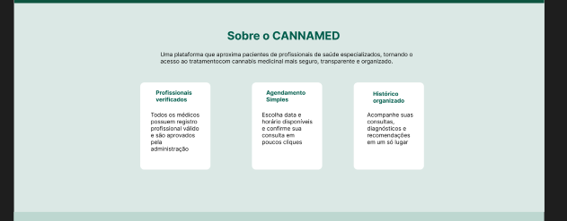
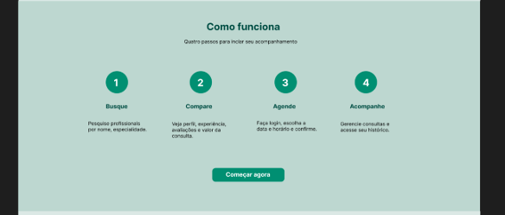
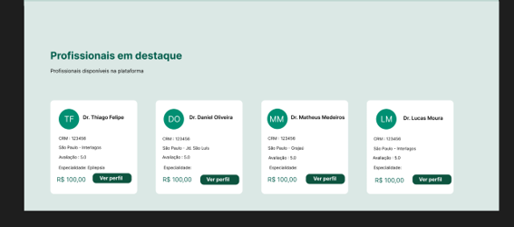
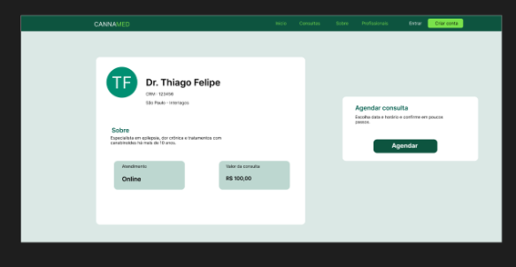
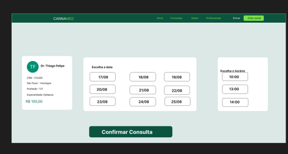
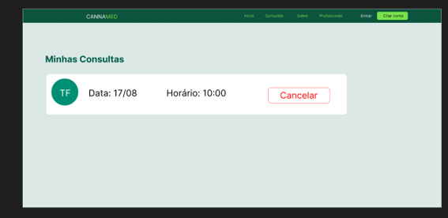
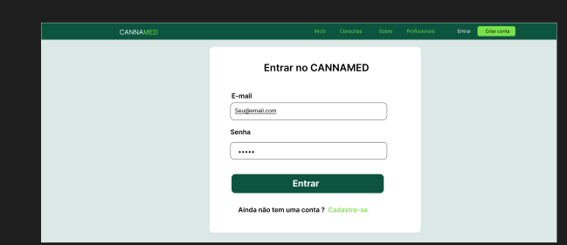
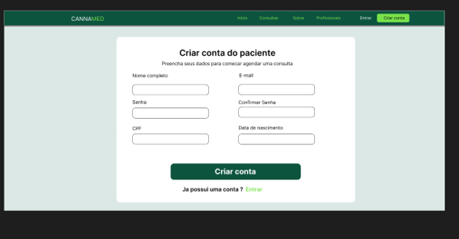
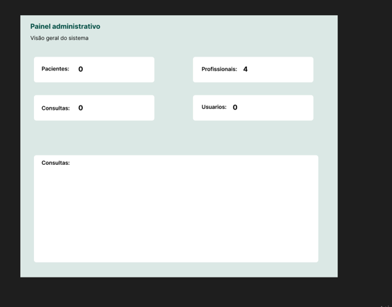
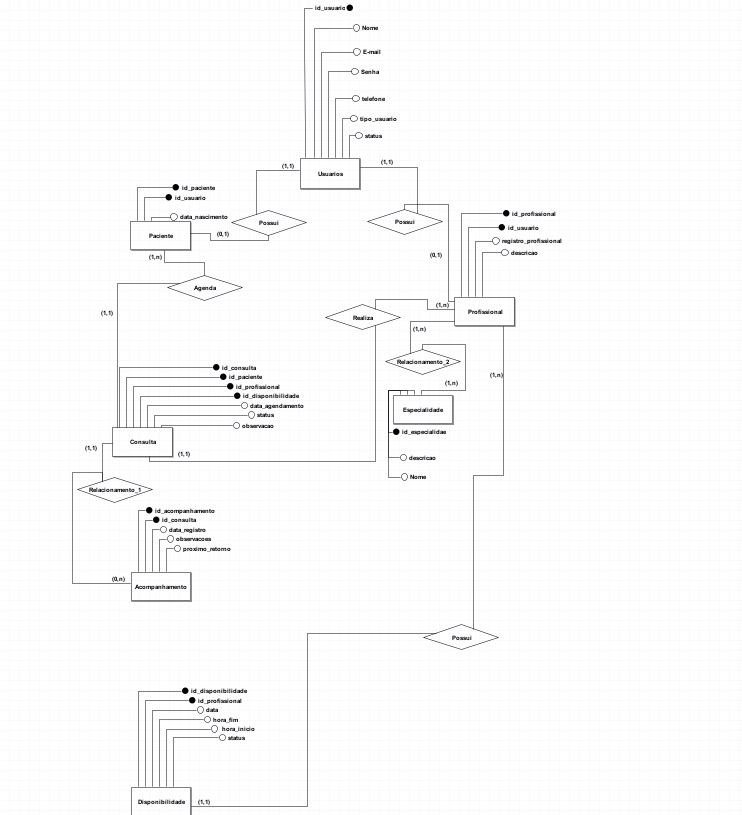

# Cannamed | Plataforma de Gestão e Agendamento

<p align="center">
  <strong>Sistema Web para Gestão de Pacientes e Agendamentos</strong>
</p>

<p align="center">
  Aplicação desenvolvida como projeto acadêmico do curso de Análise e Desenvolvimento de Sistemas.
</p>

---

## 1. Sobre o projeto

O **Cannamed** é uma aplicação web desenvolvida com o objetivo de centralizar e organizar processos de cadastro, gerenciamento de pacientes e administração de consultas em uma única plataforma.

O sistema foi concebido para oferecer uma experiência simples, organizada e intuitiva, contemplando diferentes perfis de usuários e suas respectivas necessidades.

A plataforma apresenta uma proposta de gerenciamento de atendimentos relacionados a uma clínica especializada em acompanhamento de pacientes que buscam profissionais da área de tratamento medicinal com cannabis.

Por meio de uma interface web, o sistema permite organizar informações cadastrais, controlar o acesso dos usuários e administrar dados relacionados aos atendimentos.

O desenvolvimento prioriza a separação de responsabilidades entre interface, regras de negócio, persistência de dados e controle de acesso, utilizando uma arquitetura organizada em camadas.

## 2. Demonstração visual do sistema

A seguir, estão algumas telas que representam a interface e as funcionalidades desenvolvidas para o Cannamed.

### 2.1. Identidade visual


### 2.2. Páginas institucionais

**Página principal**


**Sobre o projeto**



**Como funciona**



### 2.3. Profissionais e agendamentos

**Listagem de profissionais**



**Detalhes do profissional**



**Agendamento de consultas**



**Consultas do paciente**



### 2.4. Autenticação e cadastro

**Tela de login**



**Cadastro de usuários**



### 2.5. Área administrativa

**Painel administrativo**



### 2.6. Modelagem do banco de dados

**Diagrama desenvolvido no BRModelo**



## 2. Objetivos do sistema

- Centralizar informações de pacientes e usuários.
- Facilitar o gerenciamento administrativo da plataforma.
- Organizar informações de profissionais e especialidades.
- Disponibilizar funcionalidades de cadastro e autenticação.
- Permitir operações de consulta, edição e exclusão de registros.
- Garantir controle de acesso conforme o perfil do usuário.
- Manter a persistência das informações em banco de dados relacional.

## 3. Funcionalidades

### 3.1. Autenticação e gerenciamento de usuários

O sistema possui estrutura de autenticação para controlar o acesso às funcionalidades disponíveis.

Principais recursos:

- Cadastro de usuários.
- Autenticação por e-mail e senha.
- Validação de credenciais.
- Armazenamento de senhas utilizando BCrypt.
- Controle de sessão.
- Diferenciação de perfis de acesso.
- Restrição de funcionalidades administrativas para usuários não autorizados.

### 3.2. Gerenciamento de pacientes

O módulo de pacientes permite administrar os registros cadastrados na plataforma.

Funcionalidades:

- Cadastro de pacientes.
- Registro de nome e e-mail.
- Armazenamento de CPF.
- Registro de data de nascimento.
- Consulta de pacientes cadastrados.
- Edição de informações.
- Exclusão de registros.
- Validação de dados cadastrais.

Classes relacionadas:
- `Paciente.java`
- `PacienteDAO.java`
- `CadastroPacienteService.java`
- `PacientesServlet.java`

### 3.3. Gerenciamento de profissionais

O sistema possui estrutura para organização dos profissionais cadastrados, permitindo centralizar informações relacionadas à atuação profissional e às especialidades.

Classes relacionadas:
- `Medico.java`
- `MedicoDAO.java`

### 3.4. Gerenciamento administrativo

O módulo administrativo concentra operações de gerenciamento e controle da aplicação.

Entre suas responsabilidades estão:

- Controle de usuários.
- Gerenciamento de pacientes.
- Organização dos registros da plataforma.
- Restrição de acesso às áreas administrativas.
- Inicialização de uma conta administrativa por configuração de ambiente.

Classes relacionadas:
- `Admin.java`
- `AdminDAO.java`
- `AdminBootstrap.java`

### 3.5. Interface web

A aplicação conta com páginas desenvolvidas em HTML, CSS e JavaScript, seguindo uma identidade visual baseada em tons de verde, transmitindo uma proposta de organização, clareza e simplicidade.

Entre as páginas do projeto estão:

- Página inicial.
- Cadastro de usuários.
- Tela de autenticação.
- Perfil do usuário.
- Área de gerenciamento de pacientes.
- Área de agendamento.
- Visualização de consultas.

## 4. Tecnologias utilizadas

### Backend

| Tecnologia | Aplicação |
|---|---|
| Java | Linguagem principal do backend |
| Jakarta Servlet | Tratamento das requisições HTTP |
| JDBC | Comunicação com o banco de dados |
| Maven | Gerenciamento de dependências e construção |
| Eclipse Jetty | Servidor web para execução da aplicação |
| BCrypt | Hash de senhas |

### Frontend

| Tecnologia | Aplicação |
|---|---|
| HTML5 | Estrutura das páginas |
| CSS3 | Estilização e identidade visual |
| JavaScript | Interações e funcionalidades da interface |

### Banco de dados

| Tecnologia | Aplicação |
|---|---|
| H2 Database | Armazenamento persistente dos dados |
| SQL | Consultas e operações no banco |

## 5. Arquitetura e organização

O projeto utiliza uma organização em camadas para separar as responsabilidades da aplicação.

Essa estrutura facilita a manutenção, a leitura do código e a evolução das funcionalidades.

### Estrutura de diretórios

```text
cannamed/
│
├── backend/
│   │
│   ├── src/
│   │   └── main/
│   │       │
│   │       ├── java/
│   │       │   └── br/com/cannamed/
│   │       │       │
│   │       │       ├── controller/
│   │       │       │   ├── AdminBootstrap.java
│   │       │       │   ├── LoginServlet.java
│   │       │       │   ├── LogoutServlet.java
│   │       │       │   └── PacientesServlet.java
│   │       │       │
│   │       │       ├── dao/
│   │       │       │   ├── AdminDAO.java
│   │       │       │   ├── MedicoDAO.java
│   │       │       │   ├── PacienteDAO.java
│   │       │       │   └── UsuarioDAO.java
│   │       │       │
│   │       │       ├── model/
│   │       │       │   ├── Admin.java
│   │       │       │   ├── Medico.java
│   │       │       │   ├── Paciente.java
│   │       │       │   └── Usuario.java
│   │       │       │
│   │       │       ├── service/
│   │       │       │   └── CadastroPacienteService.java
│   │       │       │
│   │       │       └── util/
│   │       │           ├── Conexao.java
│   │       │           └── InicializadorBanco.java
│   │       │
│   │       ├── resources/
│   │       │
│   │       └── webapp/
│   │
│   └── pom.xml
│
├── docs/
├── img/
├── .gitignore
└── readme.md
```

### Responsabilidade das camadas

**Controller**

Responsável por receber as requisições HTTP, interpretar os dados enviados pelo usuário e direcionar a execução das operações.

**DAO — Data Access Object**

Responsável pela comunicação com o banco de dados, concentrando operações de inserção, consulta, atualização e exclusão.

**Model**

Contém as classes que representam as entidades e os dados utilizados pela aplicação.

**Service**

Concentra regras de negócio e operações que envolvem diferentes componentes do sistema.

**Util**

Reúne recursos auxiliares, como configuração de conexão e inicialização do banco de dados.

## 6. Banco de dados

O Cannamed utiliza o **H2 Database**, um banco de dados relacional integrado à aplicação.

A comunicação com o banco é realizada por JDBC, permitindo executar comandos SQL e manipular os registros armazenados.

A estrutura contempla as seguintes entidades:

- `usuarios`
- `pacientes`
- `profissionais`
- `especialidades`
- `disponibilidades`
- `consultas`
- `acompanhamentos`

O banco é inicializado pela aplicação por meio da classe `InicializadorBanco`.

Os dados são armazenados localmente na pasta `data`, conforme a configuração de conexão definida no projeto.

## 7. Como executar o projeto

### 7.1. Pré-requisitos

Antes de executar a aplicação, é necessário possuir:

- JDK compatível com a configuração do projeto.
- IntelliJ IDEA.
- Maven.
- Acesso à internet na primeira execução para baixar as dependências.

### 7.2. Abrindo o projeto

1. Clone o repositório.
2. Abra o IntelliJ IDEA.
3. Selecione a pasta raiz do projeto.
4. Abra o arquivo `backend/pom.xml` como projeto Maven.
5. Aguarde o carregamento das dependências.

### 7.3. Configuração do administrador

A aplicação utiliza variáveis de ambiente para configurar a conta administrativa inicial.

Configure:

```text
CANNAMED_ADMIN_EMAIL=seu-email-administrativo
CANNAMED_ADMIN_PASSWORD=sua-senha-segura
```

A senha deve possuir pelo menos 8 caracteres.

A classe `AdminBootstrap` utiliza essas configurações durante a inicialização para criar a conta administrativa caso ela ainda não exista.

Não compartilhe senhas reais no repositório.

### 7.4. Executando com Jetty pelo IntelliJ

O servidor utilizado para executar a aplicação é o **Eclipse Jetty**, integrado ao Maven.

Para iniciar:

1. Abra o painel Maven no IntelliJ IDEA.
2. Expanda o projeto `cannamed`.
3. Expanda a opção `Plugins`.
4. Localize o plugin `jetty`.
5. Expanda suas opções.
6. Execute `jetty:run`.
7. Aguarde a inicialização do servidor no painel Run.

### 7.5. Executando pelo terminal

Também é possível executar a aplicação pelo terminal, dentro da pasta `backend`:

```bash
mvn jetty:run
```

Quando o servidor estiver iniciado, acesse:

```text
http://localhost:8080/
```

Para interromper a execução, utilize o botão Stop no IntelliJ ou `Ctrl + C` no terminal.

## 8. Segurança e controle de acesso

O sistema possui mecanismos básicos de segurança para proteger o acesso às funcionalidades administrativas e aos dados cadastrados.

Entre os recursos utilizados estão:

- Armazenamento de senhas com BCrypt.
- Validação de credenciais durante o login.
- Gerenciamento de sessões HTTP.
- Controle de acesso por perfil de usuário.
- Configuração de credenciais administrativas por variáveis de ambiente.

As credenciais administrativas não devem ser armazenadas diretamente no código-fonte ou publicadas no GitHub.

## 9. Desenvolvimento e versionamento

O projeto utiliza Git e GitHub para controle de versão e organização do desenvolvimento.

O versionamento permite acompanhar alterações, manter o histórico de implementação e facilitar a colaboração entre os integrantes da equipe.

Repositório:

[GitHub — Cannamed](https://github.com/LucasMoura-dev777/cannamed)

## 10. Considerações finais

O Cannamed representa a aplicação prática de conhecimentos relacionados ao desenvolvimento web, programação orientada a objetos, persistência de dados, organização arquitetural e controle de acesso.

A proposta é construir uma plataforma organizada e de fácil utilização, que centralize operações administrativas e facilite o gerenciamento das informações relacionadas aos pacientes e atendimentos.

O projeto também proporciona a aplicação de conceitos fundamentais de desenvolvimento de software, incluindo separação de responsabilidades, integração entre frontend e backend, utilização de banco de dados relacional e controle de versão.

---

<p align="center">
  <strong>Cannamed — Organização, tecnologia e gestão em uma única plataforma.</strong>
</p>